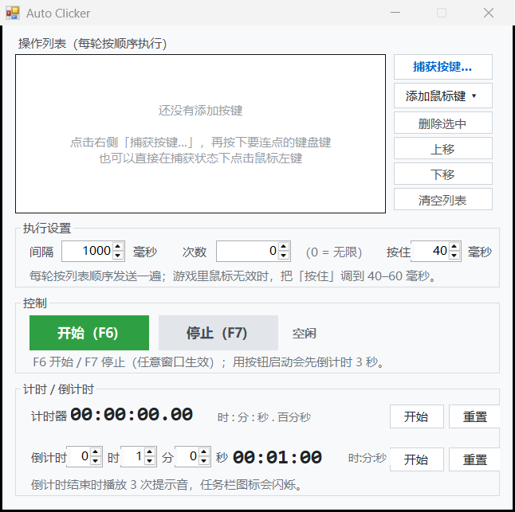

# Auto Clicker

一个面向 Windows 的连点器，支持键盘按键、鼠标按键、可调间隔/次数/按住时长，并带有秒表和倒计时。



## 下载与运行

直接下载仓库中的 `AutoClicker.exe`，双击运行即可。不需要安装 Python 或其他运行库。

- 适用于 Windows 10 / 11
- 程序是单文件绿色版，不联网、不写注册表
- 如果目标程序以管理员身份运行，请右键 `AutoClicker.exe` →「以管理员身份运行」

## 功能

- 捕获任意键盘按键，也可以直接添加鼠标左键、右键、中键、侧键 1/2
- 一个列表里可以放多个按键，每轮按列表顺序发送
- 可设置间隔、执行次数（0 = 无限）和鼠标按住时长
- 全局热键 F6 开始、F7 停止，Esc 取消捕获或取消启动倒计时
- 独立秒表：开始 / 暂停 / 继续 / 重置，精确到 0.01 秒
- 独立倒计时：时 / 分 / 秒可调，支持暂停、继续、重置
- 提示音：
  - 开始连点：上升双音
  - 停止连点 / 次数完成：下降双音
  - 倒计时结束：三音提示连续播放 3 次，并闪烁任务栏

## 使用

1. 点击「捕获按键…」，按下要连点的键盘键；在捕获状态下点击鼠标可添加鼠标键。
2. 在操作列表中调整顺序，设置间隔、次数和按住时长。
3. 把鼠标移动到目标位置，切换到目标窗口。
4. 按 F6 开始，F7 停止。

用界面上的「开始」按钮启动连点时，会先倒计时 3 秒，方便切换到目标窗口。

计时器和倒计时与连点相互独立；F6 / F7 只控制连点，不会启动或停止计时器。

## 游戏兼容说明

很多游戏按帧轮询鼠标状态。如果游戏里鼠标点击无效，把「按住」从默认的 40 毫秒调到 **60 毫秒**再试。

「按住」会计入每轮耗时；如果间隔设得比按住还短，实际间隔会以按住时长为准。

少数游戏使用独占原始输入或反作弊保护，会直接屏蔽模拟输入。这种情况软件层可能无法绕过。

## 从源码构建

需要 Windows 自带的 .NET Framework 4.x 编译器（Windows 10 / 11 默认具备）：

```powershell
.\build.ps1
```

生成文件位于 `dist\AutoClicker.exe`。

也可以直接指定输出目录：

```powershell
.\build.ps1 -OutputDirectory .\build-output
```

## 仓库结构

```text
AutoClicker-repo/
  AutoClicker.cs      主程序源码
  AutoClicker.exe     已编译的 Windows 可执行文件
  app.manifest        DPI 与权限声明
  assets/app.ico      程序图标
  build.ps1           构建脚本
  preview.png         界面预览
  README.md
```

## 说明

- 鼠标按键在「当前光标位置」点击。
- 程序不保存设置，关闭后会恢复默认值。
- 本项目目前未附带开源许可证；如果要公开发布，建议先选择合适的许可证。
